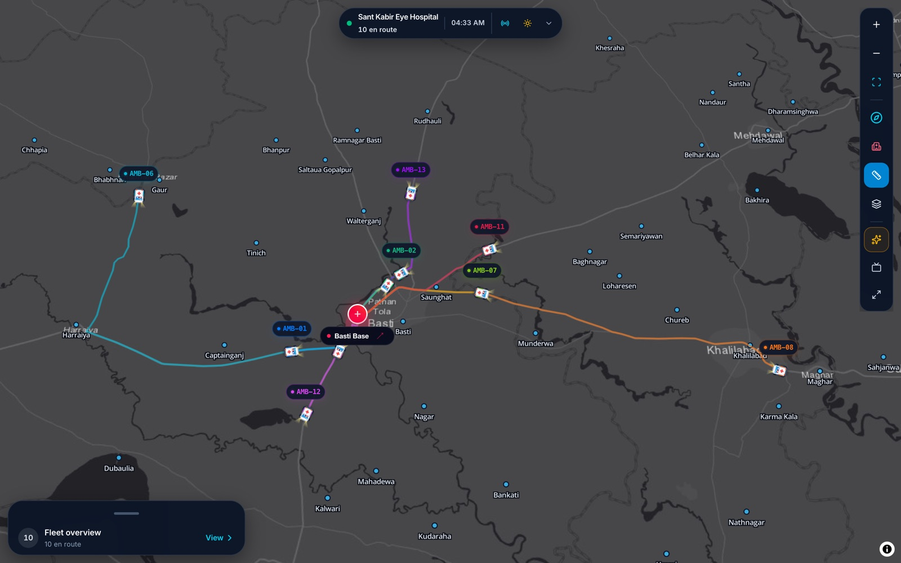
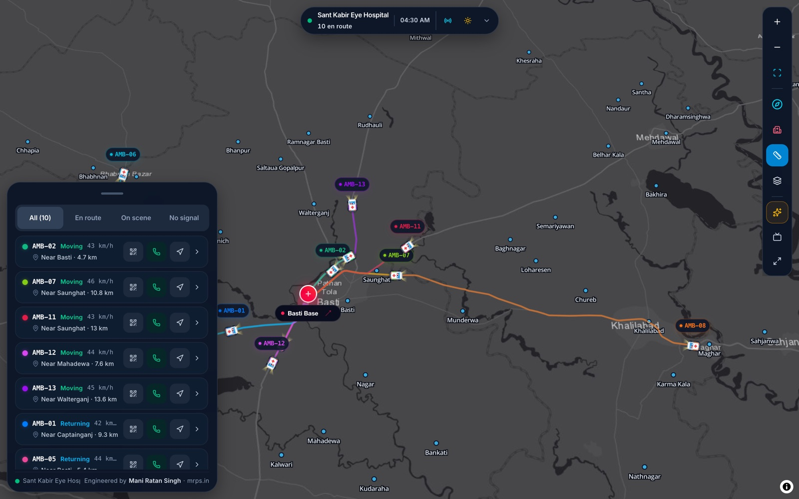
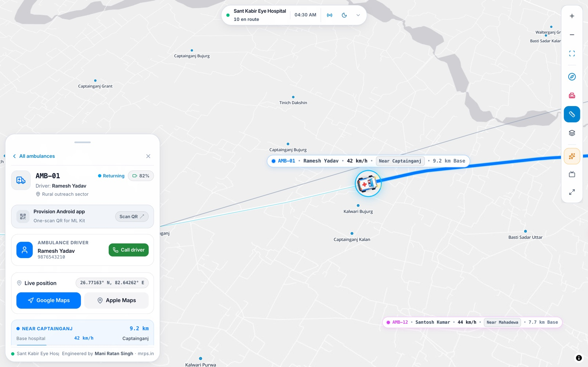
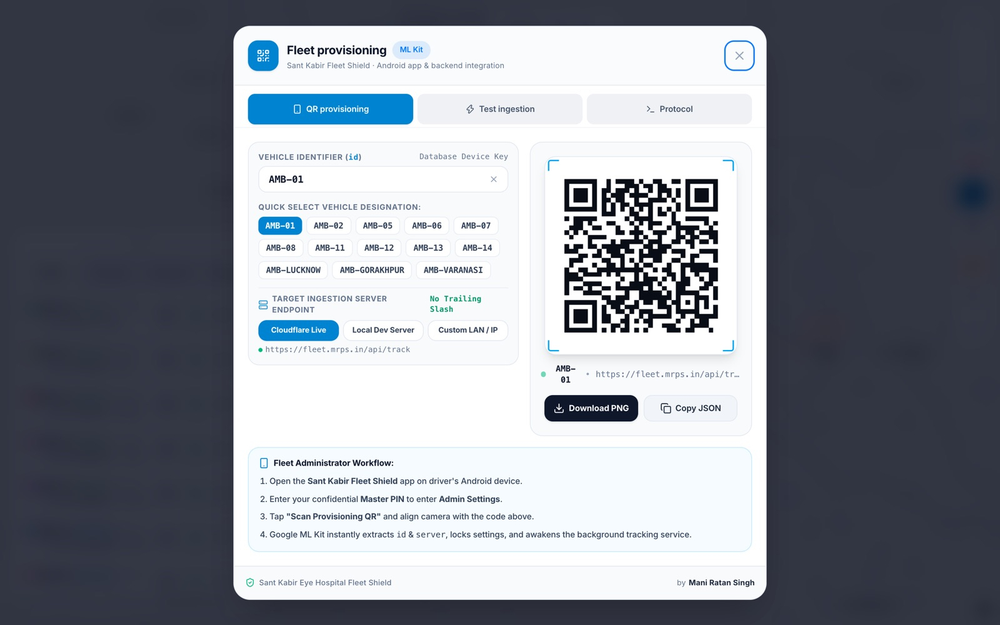
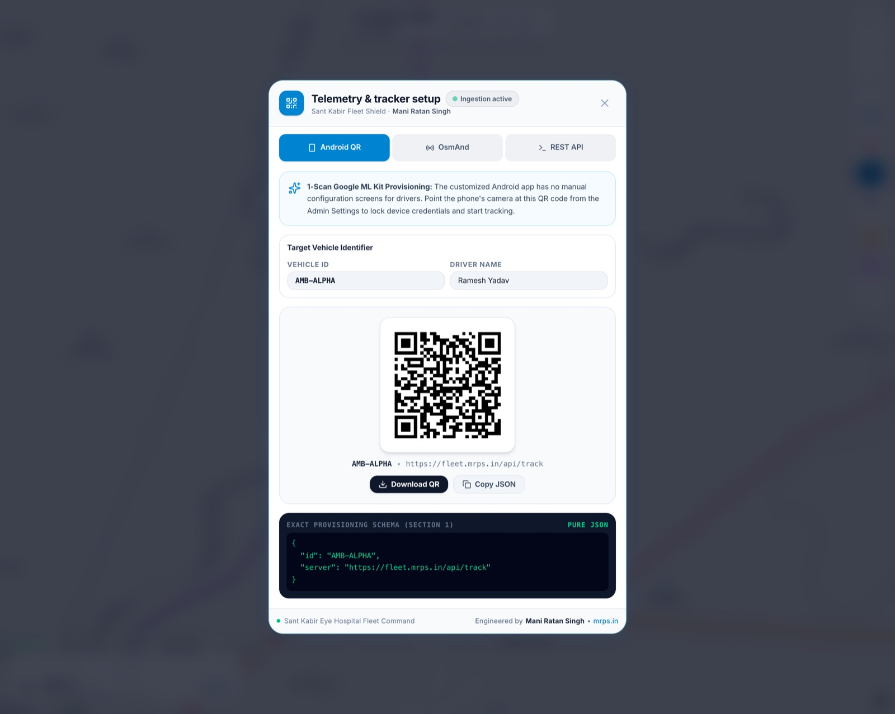
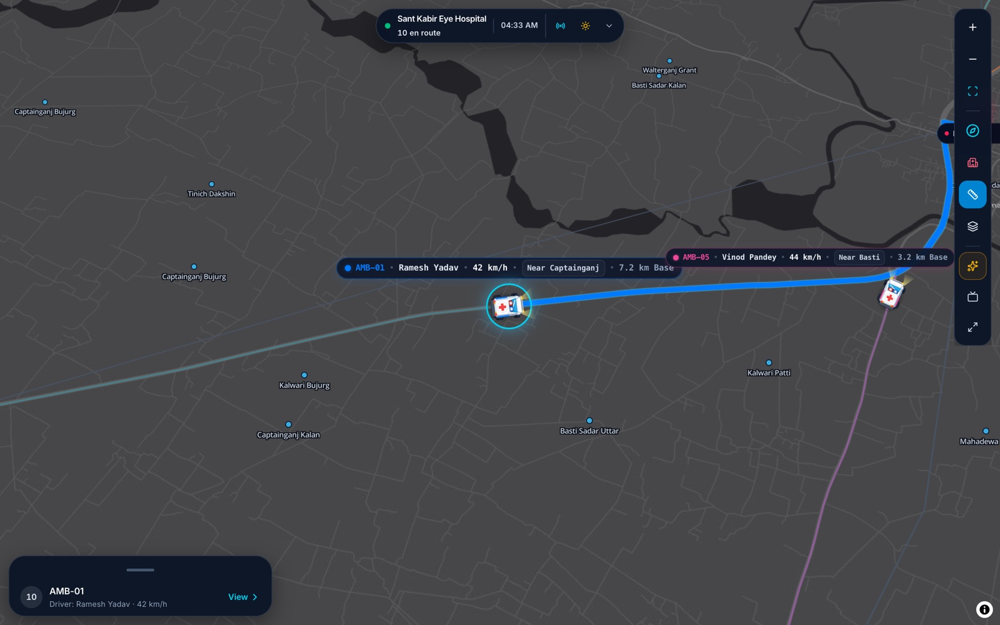
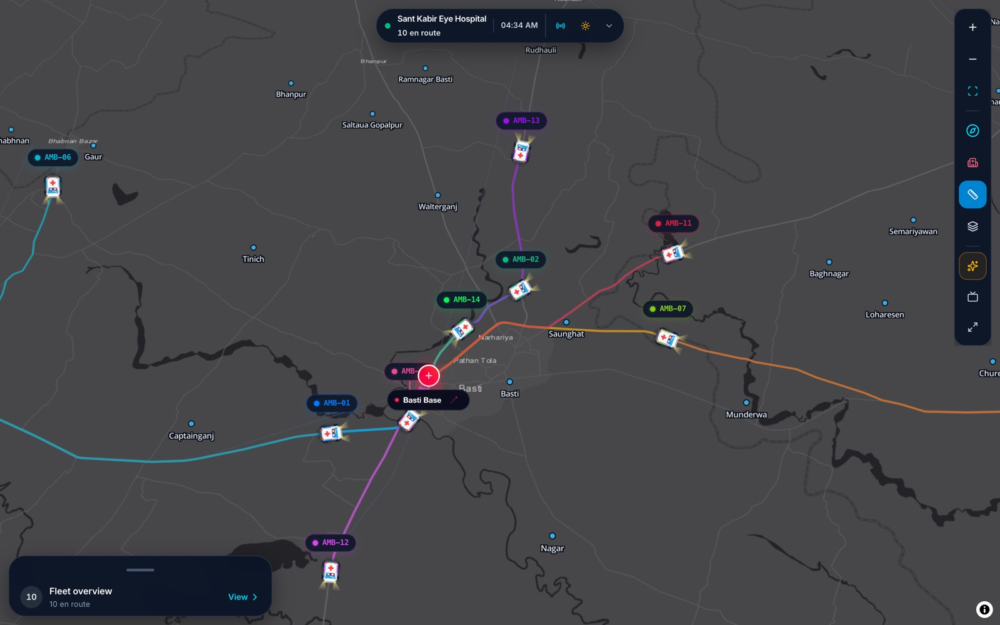

# 🛡️ Sant Kabir Fleet Shield

> **Real-Time Outreach Fleet Command & Telemetry Wallboard**  
> Engineered by **[Mani Ratan Singh](https://mrps.in)** • [github.com/maniratansingh](https://github.com/maniratansingh)  
> Operational Command Center for **Sant Kabir Eye Hospital**, Basti, Uttar Pradesh.  
> **100% Serverless on Cloudflare Workers + Durable Objects** (Zero external databases, zero servers, zero monthly hosting costs).

---

## 🧭 Overview

**Sant Kabir Fleet Shield** is an ultra-low-latency, edge-native fleet command wallboard engineered for rural medical outreach. It monitors hospital ambulances and vision screening vans dispatched from the base hospital in Basti across Eastern Uttar Pradesh.

The system pairs a hardened, private Android background client (`santkabir-fleet-shield-v1.0.apk`) with an edge-rendered command dashboard featuring Apple Maps-style precision aesthetics, 3D isometric vehicle projections, dynamic highway ribbons, and an automated TV Kiosk mode for continuous wallboard monitoring.

---

<p align="center">
  
</p>

<p align="center"><em>Fleet overview — base-anchored routes, compact tags at overview zoom, and the fleet sheet in its peek state.</em></p>

## 🌟 Current Architecture & Capabilities

```text
+--------------------------------------------------------------+
|        Sant Kabir Eye Hospital, Basti (26.797313, 82.718401) |
|                 The one and only dispatch base               |
+--------------------------------------------------------------+
                               ▲
                               │
          +--------------------+--------------------+
          │                                         │
   wss://host/api/ws?role=tracker              wss://host/api/ws
          │                                         │
+---------▼----------------+             +----------▼----------+
| Cloudflare Worker        |             | Dashboard wallboard |
| /api/track, /api/ws      |◄── snapshot ─┤ MapLibre + React   |
| static assets            |    + delta   | TV kiosk mode       |
+---------┬----------------+             +---------------------+
          │
+---------▼-------------------------------------------+
| PurvanchalFleetHub (one SQLite-backed Durable Object)|
| live fleet state · WebSocket broadcast · 60s snapshot |
+------------------------------------------------------+
```

### 1. One base, one source of truth
- **Sant Kabir Eye Hospital, Basti** is the only base: `26.797313, 82.718401`.
- Khalilabad is a town and a road destination, **not** a base, hub, or route origin.
- `src/utils/baseLocation.js` is the single shared base coordinate.
- `npm run test:routes` verifies that every village and fleet route starts within 0.75 km of Basti.

### 2. Cloudflare Worker + Durable Object
- The app deploys as a **Worker with static assets** (`wrangler deploy`), not the legacy Pages dashboard.
- `PurvanchalFleetHub` is a single SQLite-backed Durable Object and the live source of truth.
- Dashboard clients connect to `wss://<host>/api/ws`; trackers use `wss://<host>/api/ws?role=tracker`.
- WebSocket Hibernation keeps idle sockets cheap.
- The hub stores a fleet snapshot in its own SQLite every 60 seconds.

### 3. Telemetry and free-tier limits
- WebSocket is the primary tracker path. After the upgrade, messages do not count as new Worker requests.
- HTTP telemetry still works, but every request counts against the Workers Free request quota.
- 25 vehicles at 5-second HTTP = **432,000 requests/day**, which exceeds the free 100k/day allowance.
- WebSocket messages are billed to the Durable Object at roughly 20:1; 432,000 messages/day ≈ **21,600 billed DO requests/day**.
- HTTP telemetry is mirrored into the hub at most once every 30 seconds per vehicle. That throttle does not reduce the incoming Worker request count.
- The dashboard uses a **10-second HTTP polling fallback** only when the WebSocket is not connected. In demo mode it refreshes every 2 seconds.

### 4. Precomputed, base-anchored routes
- `src/data/allVillagesRoadRoutes.json` contains **195 routes**, all starting at Basti.
- `initial17Fleet.js`, `purvanchal15FleetData.*`, and `initial11Fleet.js` contain matching base-anchored route arrays.
- Routes are generated **offline** with OSRM and committed. The deployed app does not call OSRM at runtime.
- Regenerate with:
  ```bash
  npm run data:routes
  ```
- The generator is resumable and failure-safe; it will not overwrite the main file with partial data.
- The map renders route geometry only; no artificial hub or straight-line base connector is synthesized.

### 5. Rural gazetteer
- The local gazetteer has **195 named places** across the operating districts.
- The UI resolves the **current place name** from GPS; it does not schedule or predict camps.
- The demo data does not assign a camp based on proximity.

### 6. Wallboard
- **Map:** MapLibre GL. Basemaps: Light Gray, Dark Gray, Satellite, Highways & Streets.
- **Markers:** persistent DOM markers with SVG ambulances. The node is updated in place, so telemetry ticks do not rebuild the SVG or cause a blink.
- **Zoom tiers:** the icon is scaled to 56% below zoom 10.6, 78% from 10.6 to 12.4, and 100% above 12.4. The icon stays centred on the GPS point; the tag floats above it and never changes the marker's anchor.
- **Tags:** full detail at close zoom, ID only below zoom 11.2. Shelves are 0 at far zoom, 2 at mid zoom and 4 at close zoom. Vertical clamping is capped at 48 px at overview, and overlapping ID pills are suppressed at far zoom. The selected or hovered vehicle always keeps its tag.
- **Motion:** marker positions glide with `requestAnimationFrame`; the duration is matched to the telemetry interval (400–2600 ms). Jumps over 3 km snap instead of flying across the map. Tag clamp transitions run at 220 ms and shelf transitions at 420 ms.
- **Fleet sheet:** draggable spring sheet with detents at 88, 560 and 680 px, momentum projection, rubber-banding and interruptible drag.
- **Fleet states:** Moving, On scene, Returning, At base, No signal. Filters: All, En route, On scene, No signal.
- **TV auto-tour:** close-up at zoom 13.2 on desktop and 12.2 on mobile (pitch 28); overview fit capped at 12.8 / 10.8 (pitch 22). 8.5 seconds per moving vehicle, 5 seconds for a signal-gap vehicle, 6 seconds for the overview.
- **Accessibility:** rem type ramp, optical sizing, `prefers-reduced-motion`, `prefers-reduced-transparency`, `prefers-contrast`, 44 px coarse-pointer hit areas and press states.
- **Themes:** dark and light, with compact map attribution.

### 7. Branch model
- **`main`** — production. Only receives verified merges from `testing`.
- **`testing`** — QA gate. Only receives verified merges from `experimental`.
- **`experimental`** — active work. Features, fixes, documentation and screenshots start here. Not deployed.
- Do not edit `testing` or `main` directly, and do not merge `experimental` into `main`.
- Old merged branches are archived as tags.
- Full rules and promotion commands: [docs/BRANCHING.md](docs/BRANCHING.md).

### 8. Documentation
- [docs/FEATURES.md](docs/FEATURES.md) — feature reference and control map.
- [docs/BRANCHING.md](docs/BRANCHING.md) — branch rules and promotion flow.
- [docs/DATA_AND_ROUTING.md](docs/DATA_AND_ROUTING.md) — route pipeline, counts, OSRM policy and cache strategy.
- [docs/TESTING.md](docs/TESTING.md) — test suites and release checks.
- [docs/SCREENSHOTS.md](docs/SCREENSHOTS.md) — current visual gallery.
- [ARCHITECTURE.md](ARCHITECTURE.md) — system architecture and technical detail.

---

## 📸 Screenshots

<table>
  <tr>
    <td width="50%">
      
      <br /><strong>Operational fleet list</strong><br />
      Priority sorting, four filters and live vehicle states.
    </td>
    <td width="50%">
      
      <br /><strong>Vehicle detail</strong><br />
      Driver contact, coordinates, Maps links, distance and speed.
    </td>
  </tr>
  <tr>
    <td width="50%">
      
      <br /><strong>Provisioning</strong><br />
      Vehicle picker, server selection and a one-scan QR code.
    </td>
    <td width="50%">
      
      <br /><strong>Telemetry setup</strong><br />
      Android QR, OsmAnd and REST API tabs with the exact schema.
    </td>
  </tr>
  <tr>
    <td width="50%">
      
      <br /><strong>Marker close-up</strong><br />
      The tag sits above the icon; the icon stays on the GPS point.
    </td>
    <td width="50%">
      
      <br /><strong>Route anchoring</strong><br />
      Every visible corridor converges on Sant Kabir Eye Hospital, Basti.
    </td>
  </tr>
</table>

[Open the full gallery](docs/SCREENSHOTS.md) — includes the light overview, fleet summary and mobile views.

## 🛰️ Edge Telemetry API Specification

### 1. Telemetry Ingestion Endpoint
- **URL**: `/api/track` (Traccar OsmAnd) or `/api/location`
- **Methods**: `POST` (JSON/FormData) or `GET` (Query parameters)
- **CORS**: `Access-Control-Allow-Origin: *`
- **Speed**: OsmAnd packets send knots; JSON packets may send km/h. The processor normalizes both.

#### Query / JSON Parameters:
| Field | Type | Description |
| :--- | :--- | :--- |
| `id` / `uniqueId` | `string` | **Required**. Unique ambulance identifier (e.g., `SK-AMB-01`) |
| `lat` / `latitude` | `number` | **Required**. GPS latitude (-90.0 to 90.0) |
| `lon` / `longitude` | `number` | **Required**. GPS longitude (-180.0 to 180.0) |
| `driver` | `string` | Assigned driver name (e.g., `Ramesh Yadav`) |
| `speed` | `number` | Speed in knots or km/h (auto-detected and normalized) |
| `bearing` | `number` | Heading angle in degrees (0° - 360°) |
| `altitude` | `number` | Elevation in meters |
| `batt` / `battery`| `number` | Device battery percentage (0 - 100) |
| `timestamp` | `number` | Epoch timestamp in milliseconds |

#### Sample Ingestion Request:
```bash
curl -X POST https://your-pages-domain.pages.dev/api/location \
  -H "Content-Type: application/json" \
  -d '{
    "id": "SK-AMB-01",
    "driver": "Ramesh Yadav",
    "lat": 26.8500,
    "lon": 82.8500,
    "speed": 45,
    "bearing": 120,
    "batt": 92
  }'
```

### 2. Vehicle Retrieval Endpoint
- **URL**: `/api/vehicles`
- **Method**: `GET`
- **Response**:
```json
{
  "success": true,
  "vehicles": [
    {
      "id": "SK-AMB-01",
      "name": "Ambulance SK-AMB-01",
      "driverName": "Ramesh Yadav",
      "status": "moving",
      "lat": 26.850000,
      "lon": 82.850000,
      "speed": 45,
      "bearing": 120,
      "distFromBaseKm": 14.3,
      "roadDistFromBaseKm": 16.4,
      "batt": 92,
      "battery": 92,
      "lineColor": "#007AFF",
      "glowColor": "#38BDF8",
      "lastSeen": 1792171500000
    }
  ],
  "count": 1,
  "app": "Sant Kabir Fleet Shield",
  "developer": "Mani Ratan Singh (mrps.in)"
}
```

---

## 💻 Local Development

```bash
# 1. Clone repository
git clone https://github.com/maniratansingh/santkabir-fleet-shield.git
cd santkabir-fleet-shield

# 2. Install dependencies
npm install

# 3. Start local development server
npm run dev

# 4. Build production bundle
npm run build

# 5. Preview production build locally
npm run preview

# 6. Run verification
npm test                  # master contract + route anchor guard
npm run test:kalman
npm run test:map-matching
npm run test:do-ws        # requires wrangler dev on :8787
npm run test:routes       # route origin guard only
```

---

## ☁️ Deployment Guide

### Deploy with Wrangler (Workers + static assets)

```bash
npm run build
npx wrangler deploy
```

Set the admin key used by `POST/DELETE /api/clear`:

```bash
npx wrangler secret put ADMIN_SECRET_KEY
```

Do **not** deploy this version through the legacy Pages dashboard. `wrangler.toml` defines the Worker entry, the static asset binding (`ASSETS`), and the `FLEET_HUB` Durable Object binding.

For local development:

```bash
ADMIN_SECRET_KEY=dev-admin-key npm run dev
```

### Durable Object WebSocket Hub

The project now deploys as a Worker with static assets (`wrangler deploy`), not
through the legacy Pages dashboard. `wrangler.toml` binds one SQLite-backed
`PurvanchalFleetHub` Durable Object:

- Dashboard clients connect to `wss://<host>/api/ws`.
- Field trackers connect to `wss://<host>/api/ws?role=tracker` and send either a
  JSON telemetry object or a compact array
  `[id, lat, lon, speed, bearing, timestamp]`. Speed is in knots, matching the
  Traccar/OsmAnd contract. The hub processes the packet with the shared
  telemetry processor, acknowledges the tracker, and broadcasts a `delta` to
  every dashboard.
- The hub sends a snapshot on connect and a `delta` message when a vehicle moves.
- Shared processing lives in `src/utils/telemetryProcessor.js`, with shared
  geospatial helpers in `src/utils/geo.js`, `src/utils/village.js`, and
  `src/utils/baseLocation.js`.
- Idle sockets use the WebSocket Hibernation API, so they do not accrue
  duration charges while nothing is being sent.
- HTTP telemetry is mirrored into the hub at most once every 30 seconds per
  vehicle to stay inside the Workers Free / Durable Objects 100,000 request/day
  allowance. WebSocket tracker ingestion bypasses that throttle.
- The hub stores a fleet snapshot in its own SQLite storage every 60 seconds
  (1,440 writes/day). A D1 binding can replace this later; no D1 database is
  required for the free deployment.
- The dashboard keeps a 10-second HTTP polling fallback for browsers that cannot
  establish a WebSocket. It does not poll while the socket is connected.
- Verify the hub locally with `npx wrangler dev --port 8787 --local` and
  `node scripts/verify_do_ws.mjs` (13 checks, including a tracker socket and a
  compact-array packet).

---

## 📱 Master Integration Specification (Android App ↔ Web Backend)

The system is fully integrated with the customized **Sant Kabir Fleet Shield Android App** utilizing the **Traccar OsmAnd Protocol**.

### 1. The Provisioning Contract (QR Code)
The Android app has been stripped of manual configuration screens for drivers. Devices are provisioned by the Fleet Administrator scanning a QR Code generated directly on the web dashboard (via the **View Vehicle** panel or **Telemetry Modal**).

**Strict QR Code Schema:**
```json
{
  "id": "UNIQUE_VEHICLE_ID",
  "server": "https://fleet.mrps.in/api/track"
}
```
* **`id`**: Exact identifier stored in the web database (e.g. `AMB-01`, `VEHICLE-102`).
* **`server`**: Exact, full URL of the ingestion endpoint (**no trailing slash**).
* Uses Google ML Kit on Android to lock credentials and instantly start the background tracking daemon.

### 2. The Data Ingestion Contract (OsmAnd Protocol)
* **Method**: HTTP `POST`
* **Content-Type**: `application/x-www-form-urlencoded`
* **URL Structure**: All data is passed as URL-encoded query parameters.
```http
POST /api/track?id=VEHICLE-102&timestamp=1697632824&lat=26.8467&lon=80.9462&speed=12.5&bearing=180.0&altitude=120.0&accuracy=10.0&batt=85.0&charge=true HTTP/1.1
Host: fleet.mrps.in
```

**Parameter Dictionary:**
* `id` = (String) Device identifier.
* `timestamp` = (Long) Epoch time in seconds (UTC).
* `lat` = (Double) Latitude (-90 to 90).
* `lon` = (Double) Longitude (-180 to 180).
* `speed` = (Double) Speed in knots (multiplied by 1.852 to get km/h).
* `bearing` = (Double) Heading in degrees (0–360°).
* `altitude` = (Double) Altitude in meters.
* `accuracy` = (Double) GPS accuracy margin in meters.
* `batt` = (Double) Device battery level (0.0 to 100.0).
* `charge` = (Boolean) `true` if charging, `false` if discharging.

**Server Response:**
* Returns an immediate `HTTP 200 OK` response (`{"success": true, ...}`).

### 3. Cloudflare & Infrastructure Setup
1. **Port 443 Standard HTTPS**: Traffic is terminated on port 443 via the Cloudflare Worker.
2. **Cloudflare WAF Custom Rule**:
   * Navigate to **Cloudflare Dashboard** $\rightarrow$ **Security** $\rightarrow$ **WAF** $\rightarrow$ **Custom Rules**.
   * Action: **Bypass / Skip** Bot Fight Mode and Browser Integrity Check.
   * Expression: `(http.request.uri.path contains "/api/track")`

---

## 👨‍💻 Engineering & Authorship

- **Architect & Developer**: [Mani Ratan Singh](https://mrps.in)  
- **Website**: [https://mrps.in](https://mrps.in)  
- **GitHub**: [@maniratansingh](https://github.com/maniratansingh)  
- **Base Hospital**: Sant Kabir Eye Hospital, Bansi Road, near Pindari Hospital, Katra, Basti, Uttar Pradesh 272001
