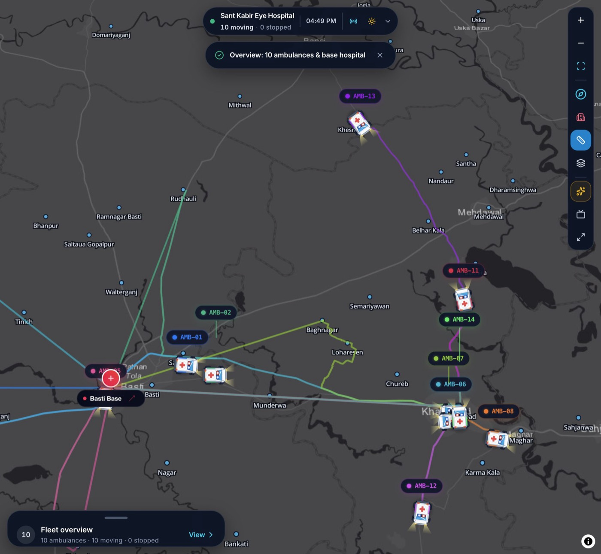
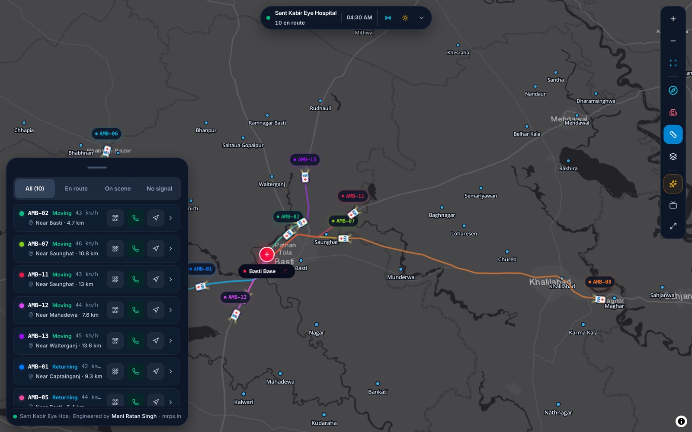
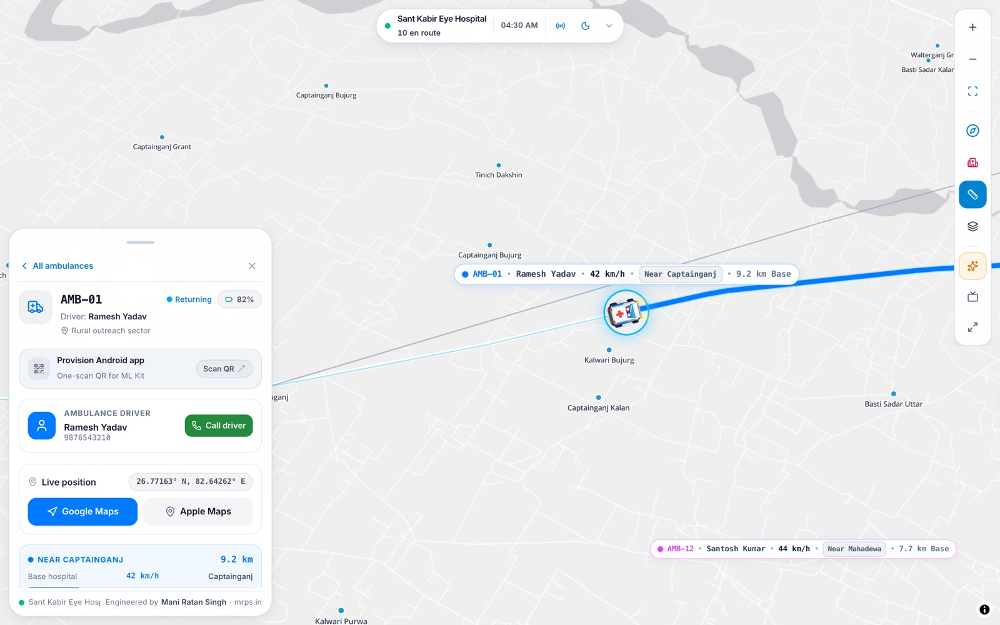
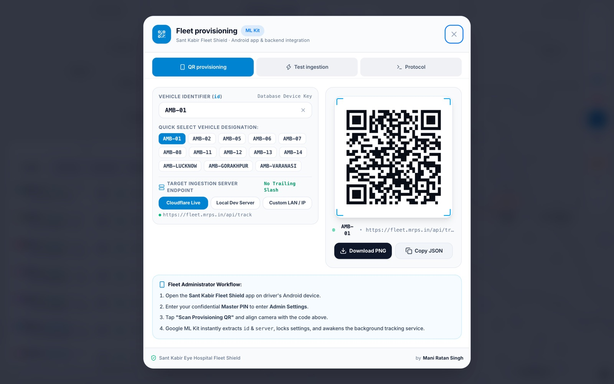
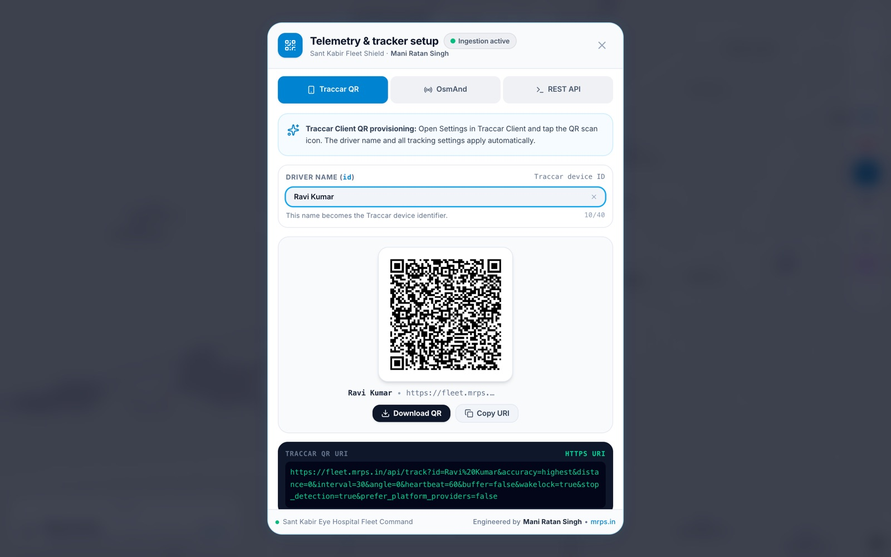
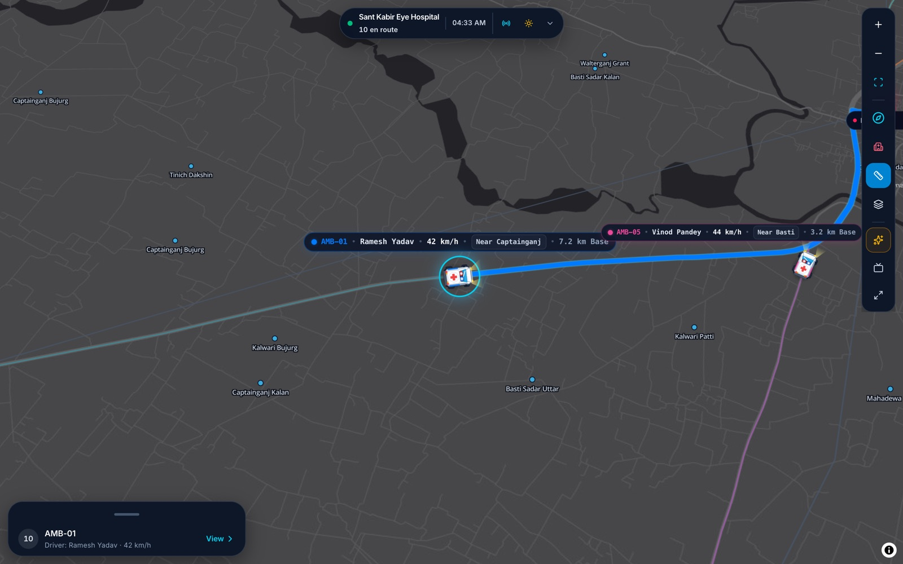
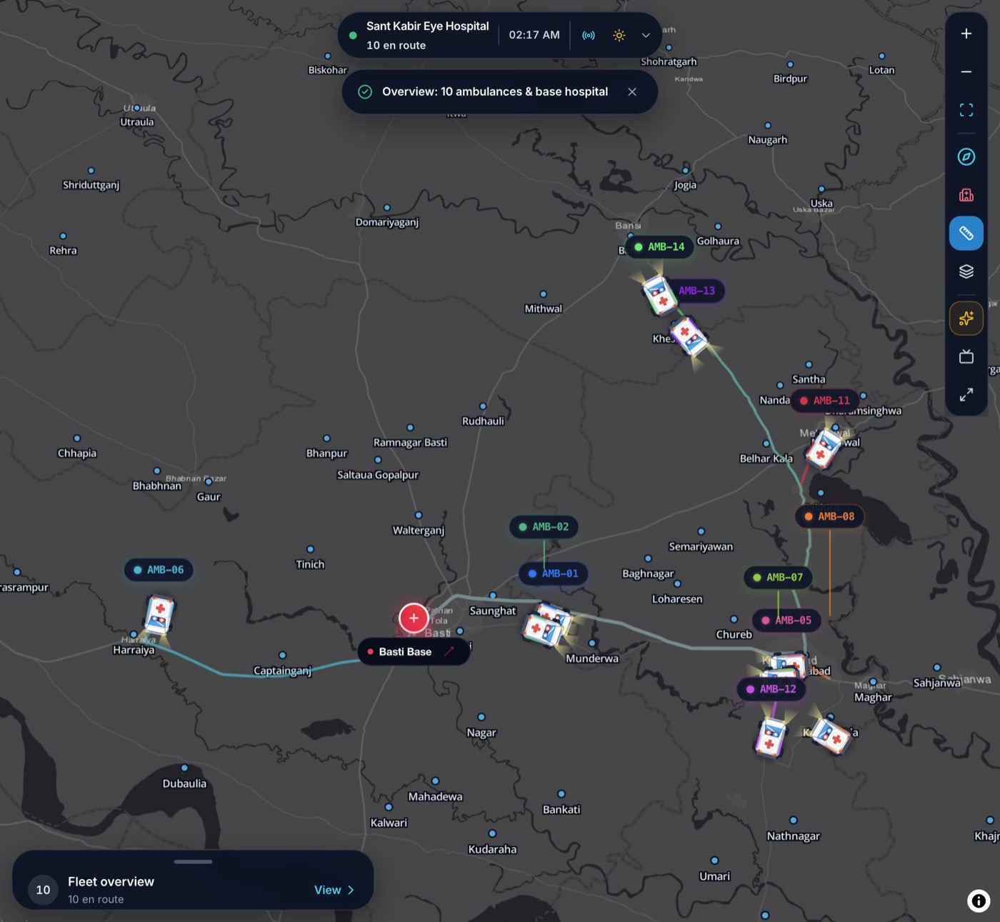

# 🛡️ Sant Kabir Fleet Shield

> **Real-Time Outreach Fleet Command & Telemetry Wallboard**  
> Engineered by **[Mani Ratan Singh](https://mrps.in)** • [github.com/maniratansingh](https://github.com/maniratansingh)  
> Operational Command Center for **Sant Kabir Eye Hospital**, Basti, Uttar Pradesh.  
> **100% Serverless on Cloudflare Workers + Durable Objects** (Zero external databases, zero servers, zero monthly hosting costs).

---

## 🧭 Overview

**Sant Kabir Fleet Shield** is an ultra-low-latency, edge-native fleet command wallboard engineered for rural medical outreach. It monitors hospital ambulances and vision screening vans dispatched from the base hospital in Basti across Eastern Uttar Pradesh.

Field phones run the standard **Traccar Client**, provisioned by a one-scan QR generated in the dashboard. The driver name is the device ID: there is no separate vehicle ID. The legacy Sant Kabir Android APK contract is still accepted by the telemetry API.

The dashboard features Apple Maps-style precision aesthetics, 3D isometric vehicle projections, road-only trails, persistent last-seen records, and an automated TV Kiosk mode for continuous wallboard monitoring.

---

<p align="center">
  
</p>

<p align="center"><em>Fleet overview — base-anchored routes, compact tags at overview zoom, and the fleet sheet in its peek state.</em></p>

## 🆕 Latest Changes (16 November 2026)

The history service is now a full map-first reporting experience, backed by one
Durable Object.

- **One state object.** `FleetHistory` (binding `FLEET_HUB`) owns live state,
  history, reports and the single WebSocket. One `/ingest` per fix updates all
  three; the second DO, duplicate write and 30-second forward throttle are gone.
- **30-day history.** `history_points` is keyed by `(vehicle_id, device_time)`
  and keeps 30 days. Raw and filtered coordinates are stored. Reads allow up to
  100,000 rows; the map is downsampled to ~7,000 points. One history call returns
  the points plus the reports, so a range change scans the rows once.
- **Server-side reports.** `/api/history` returns daily summary, trips and stops
  computed from the same rows the map uses. The hero, timeline, stops and tables
  all come from that one response, so they cannot disagree.
- **Simple and Advanced views.** Simple is vehicle, range, one unified trail, 3D
  ambulance, speed pill, play/speed/follow and the timeline. Advanced adds
  Maps/Trips, Summary/Trips/Stops tables, chips, accuracy, speed colouring and
  CSV. Toggling Advanced resets Advanced-only state.
- **Unified trail and breaks.** All trips and days are threaded into one picture.
  Stop gaps use the vehicle colour; real data breaks use amber links with
  anchors in dark and light mode.
- **Moving vehicle.** The 3D ambulance is shared with the live board, rotates
  with heading, shows live speed, and the camera flies to the new bounds on a
  vehicle or range change.
- **Playback.** 1× scales with the range: about 1 min for 2 hours, 3 min for 24 hours, 5 min for 7 days and 10 min for 30 days. Speeds are 0.25×, 0.5×, 1×, 2×, 4×, 8× and 16×, so long ranges can be watched slowly or scanned quickly.
  Loading uses one report call and a deliberate progress card.
- **Telemetry.** Live window is 180 seconds (matching the real ~100 s cadence),
  timestamps normalise seconds/ISO to milliseconds, offline buffering is on, and
  the dashboard ignores empty poll responses and half-open sockets.
- **Deploy.** Wrangler 4.162.0 with the `fleet.mrps.in` custom-domain route;
  `workers.dev` and preview URLs disabled.

`testing` is the branch deployed at `https://fleet.mrps.in`.
`experimental` and `main` are untouched.

Verified on 16 November 2026: build pass, 240/240 route anchors, 8/8 Kalman,
6/6 map matching.

## 🌟 Current Architecture & Capabilities

```text
+--------------------------------------------------------------+
|        Sant Kabir Eye Hospital, Basti (26.797313, 82.718401) |
|                 The one and only dispatch base               |
+--------------------------------------------------------------+
                               ▲
                               │
          +--------------------+--------------------+
          │                                         │
   wss://host/api/ws?role=tracker              wss://host/api/ws
          │                                         │
+---------▼----------------+             +----------▼----------+
| Cloudflare Worker        |             | Dashboard wallboard |
| /api/track, /api/ws      |◄── snapshot ─┤ MapLibre + React   |
| /api/vehicles            |    + delta  | TV kiosk mode       |
| /api/remove (admin)      |             | offline + last seen |
| static assets            |             +---------------------+
+---------┬----------------+
          │
+---------▼-------------------------------------------+
| FleetHistory (one SQLite-backed Durable Object)      |
| live fleet · WebSocket · history · reports           |
| 30-day points · live/no-signal/parked/offline        |
+------------------------------------------------------+
```

### 1. One base, one source of truth
- **Sant Kabir Eye Hospital, Basti** is the only base: `26.797313, 82.718401`.
- Khalilabad is a town and a road destination, **not** a base, hub, or route origin.
- `src/utils/baseLocation.js` is the single shared base coordinate.
- `npm run test:routes` verifies that every village and fleet route starts within 0.75 km of Basti.

### 2. Cloudflare Worker + Durable Object
- The app deploys as a **Worker with static assets** (`wrangler deploy`), not the legacy Pages dashboard.
- `FleetHistory` (binding `FLEET_HUB`) is the single SQLite-backed Durable Object and owns live state, history, reports and WebSocket broadcast.
- Dashboard clients connect to `wss://<host>/api/ws`; trackers use `wss://<host>/api/ws?role=tracker`.
- WebSocket Hibernation keeps idle sockets cheap.
- The hub persists changes to its own SQLite within **5 seconds** and keeps fleet records long-term. Going quiet marks a record **Offline**; it does not delete it.
- On load, the hub canonicalises stored IDs, so legacy spellings collapse into one record instead of becoming ghosts.
- `POST /api/remove` (admin key) removes one or more records and broadcasts a `remove` event to every dashboard.

### 2a. Vehicle lifecycle and identity
| Age since last packet | State | Map behaviour |
|---|---|---|
| under 60 s | **Live** | normal marker and road trail |
| 60 s – 15 min | **No signal** | amber marker, gap badge |
| 15 – 35 min | **Parked** | slate marker, last position |
| over 35 min | **Offline** | grey marker, “Last seen X ago”, no trail |

- The driver name **is** the device ID. There is no second vehicle ID.
- `canonicalVehicleId` trims, collapses repeated whitespace and uppercases, so one phone always updates one record.
- A new packet from the same ID moves the record back to Live at the new position.
- Offline records are excluded from live counts, trails and the TV auto-tour, but stay visible under the **Offline** filter.

### 3. Telemetry and free-tier limits
- The field path is **HTTP**: Traccar Client posts to `/api/track`. Each fix is one HTTP request and one Durable Object `/ingest` call.
- HTTP telemetry still works, but every request counts against the Workers Free request quota.
- 25 vehicles at 5-second HTTP = **432,000 requests/day**, which exceeds the free 100k/day allowance.
- WebSocket messages are billed to the Durable Object at roughly 20:1; 432,000 messages/day ≈ **21,600 billed DO requests/day**.
- HTTP telemetry is no longer throttled before the hub. The 30-second forward throttle was removed with the single-DO refactor.
- The dashboard uses a **10-second HTTP polling fallback** only when the WebSocket is not connected. In demo mode it refreshes every 2 seconds.
- While the socket is connected, the dashboard requests a fresh snapshot every **60 seconds** to reconcile browser state and drop removed IDs. A 45-second pong watchdog closes half-open sockets.
- Live/no-signal uses a **180-second** window, matching the real ~100-second device cadence.

### 4. Precomputed, base-anchored routes
- `src/data/allVillagesRoadRoutes.json` contains **195 routes**, all starting at Basti.
- `initial17Fleet.js`, `purvanchal15FleetData.*`, and `initial11Fleet.js` contain matching base-anchored route arrays.
- Routes are generated **offline** with OSRM and committed. The deployed app does not call OSRM at runtime.
- Regenerate with:
  ```bash
  npm run data:routes
  ```
- The generator is resumable and failure-safe; it will not overwrite the main file with partial data.
- The map renders route geometry only; no artificial hub or straight-line base connector is synthesized.

### 5. Rural gazetteer
- The local gazetteer has **195 named places** across the operating districts.
- The UI resolves the **current place name** from GPS; it does not schedule or predict camps.
- The demo data does not assign a camp based on proximity.

### 6. Wallboard
- **Map:** MapLibre GL. Basemaps: Light Gray, Dark Gray, Satellite, Highways & Streets.
- **Markers:** persistent DOM markers with SVG ambulances. The node is updated in place, so telemetry ticks do not rebuild the SVG or cause a blink.
- **Zoom tiers:** the icon is scaled to 56% below zoom 10.6, 78% from 10.6 to 12.4, and 100% above 12.4. The icon stays centred on the GPS point; the tag floats above it and never changes the marker's anchor.
- **Tags:** full detail at close zoom, ID only below zoom 11.2. Shelves are 0 at far zoom, 2 at mid zoom and 4 at close zoom. Vertical clamping is capped at 48 px at overview, and overlapping ID pills are suppressed at far zoom. The selected or hovered vehicle always keeps its tag.
- **Motion:** marker positions glide with `requestAnimationFrame`; the duration is matched to the telemetry interval (400–2600 ms). Jumps over 3 km snap instead of flying across the map. Tag clamp transitions run at 220 ms and shelf transitions at 420 ms.
- **Fleet sheet:** draggable spring sheet with detents at 88, 560 and 680 px, momentum projection, rubber-banding and interruptible drag.
- **Share:** each vehicle row and the selected-vehicle panel have a Share action. It produces `https://fleet.mrps.in/?vehicle=<ID>`, which opens the same board filtered to that one vehicle. On mobile it uses the native share sheet (WhatsApp, etc.); on desktop it copies the link. No expiry or server-side token is used. The shared view has no “Full fleet” or “All ambulances” exit, and closing the vehicle sheet never clears the one-vehicle filter.
- **Fleet states:** Moving, On scene, Returning, At base, No signal and Offline. Filters: All, En route, On scene, No signal, Offline.
- **Offline rows:** grey marker, “Last seen X ago”, no road trail, excluded from live counts and the TV auto-tour. A Remove action is available with the admin key.
- **TV auto-tour:** close-up at zoom 13.2 on desktop and 12.2 on mobile (pitch 28); overview fit capped at 12.8 / 10.8 (pitch 22). 8.5 seconds per moving vehicle, 5 seconds for a signal-gap vehicle, 6 seconds for the overview. Offline vehicles are skipped.
- **Pinned TV tour:** pin one or more vehicles from the fleet row or selected-vehicle panel. While any vehicle is pinned, the TV auto-tour follows only the pinned reporting vehicles and skips the fleet-overview cut-away. Remove all pins to restore the normal full-fleet tour. Pins are remembered in the browser.
- **Mobile:** bottom navigation with Map, Fleet, Alerts and More. The desktop dock and layout are unchanged; the fleet sheet sits above the bottom bar.
- **Accessibility:** rem type ramp, optical sizing, `prefers-reduced-motion`, `prefers-reduced-transparency`, `prefers-contrast`, 44 px coarse-pointer hit areas and press states.
- **Themes:** dark and light, with compact map attribution.

### 7. Branch model
- **`main`** — production promotion target. Receives verified merges from `testing`.
- **`testing`** — active history work and the branch currently deployed at `https://fleet.mrps.in`. This phase is committed and pushed here.
- **`experimental`** — frozen reference base for this phase. Do not edit or push to it.
- Do not merge `testing` into `experimental`; promote `testing` to `main` only after verification.
- Old merged branches are archived as tags.
- Full rules and promotion commands: [docs/BRANCHING.md](docs/BRANCHING.md).

### 8. Documentation
- [docs/HANDOVER.md](docs/HANDOVER.md) — current state and next-session start guide.
- [docs/FEATURES.md](docs/FEATURES.md) — feature reference and control map.
- [docs/BRANCHING.md](docs/BRANCHING.md) — branch rules and promotion flow.
- [docs/DATA_AND_ROUTING.md](docs/DATA_AND_ROUTING.md) — route pipeline, counts, OSRM policy and cache strategy.
- [docs/TESTING.md](docs/TESTING.md) — test suites and release checks.
- [docs/SCREENSHOTS.md](docs/SCREENSHOTS.md) — current visual gallery.
- [ARCHITECTURE.md](ARCHITECTURE.md) — system architecture and technical detail.

---

## 📸 Screenshots

<table>
  <tr>
    <td width="50%">
      
      <br /><strong>Operational fleet list</strong><br />
      Priority sorting and live vehicle states. The current build adds the Offline filter.
    </td>
    <td width="50%">
      
      <br /><strong>Vehicle detail</strong><br />
      Driver contact, coordinates, Maps links, distance and speed.
    </td>
  </tr>
  <tr>
    <td width="50%">
      
      <br /><strong>Provisioning</strong><br />
      Driver name, server selection and a one-scan Traccar QR.
    </td>
    <td width="50%">
      
      <br /><strong>Telemetry setup</strong><br />
      Android QR, OsmAnd and REST API tabs with the exact schema.
    </td>
  </tr>
  <tr>
    <td width="50%">
      
      <br /><strong>Marker close-up</strong><br />
      The tag sits above the icon; the icon stays on the GPS point.
    </td>
    <td width="50%">
      
      <br /><strong>Route anchoring</strong><br />
      Every visible corridor converges on Sant Kabir Eye Hospital, Basti.
    </td>
  </tr>
</table>

[Open the full gallery](docs/SCREENSHOTS.md) — includes the light overview, fleet summary and mobile views.

## 🛰️ Edge Telemetry API Specification

### 1. Telemetry Ingestion Endpoint
- **URL**: `/api/track` (Traccar OsmAnd) or `/api/location`
- **Methods**: `POST` (JSON/FormData) or `GET` (Query parameters)
- **CORS**: `Access-Control-Allow-Origin: *`
- **Speed**: OsmAnd packets send knots; JSON packets may send km/h. The processor normalizes both.
- **Identity**: the `id` is the driver name used as the device ID. It is trimmed,
  whitespace-collapsed and uppercased (`ramesh  yadav` → `RAMESH YADAV`). There
  is no separate vehicle ID.

#### Query / JSON Parameters:
| Field | Type | Description |
| :--- | :--- | :--- |
| `id` / `uniqueId` | `string` | **Required**. Driver name used as the device ID (e.g., `RAMESH YADAV`) |
| `lat` / `latitude` | `number` | **Required**. GPS latitude (-90.0 to 90.0) |
| `lon` / `longitude` | `number` | **Required**. GPS longitude (-180.0 to 180.0) |
| `driver` | `string` | Optional legacy display name. The `id` remains the identity. |
| `speed` | `number` | Speed in knots or km/h (auto-detected and normalized) |
| `bearing` | `number` | Heading angle in degrees (0° - 360°) |
| `altitude` | `number` | Elevation in meters |
| `batt` / `battery`| `number` | Device battery percentage (0 - 100) |
| `timestamp` | `number` | Epoch timestamp in milliseconds |

#### Sample Ingestion Request:
```bash
curl -X POST https://fleet.mrps.in/api/track \
  -H "Content-Type: application/json" \
  -d '{
    "id": "RAMESH YADAV",
    "lat": 26.8500,
    "lon": 82.8500,
    "speed": 45,
    "bearing": 120,
    "batt": 92
  }'
```

### 2. Vehicle Retrieval Endpoint
- **URL**: `/api/vehicles`
- **Method**: `GET`
- **State fields**: `isLive`, `isSignalGap`, `isParked`, `isOffline`,
  `networkState`, `ageSec`, `gapMinutes`. These are derived from the last
  packet age, not stored flags.
- **Response**:
```json
{
  "success": true,
  "vehicles": [
    {
      "id": "RAMESH YADAV",
      "name": "RAMESH YADAV",
      "driverName": "",
      "status": "moving",
      "lat": 26.850000,
      "lon": 82.850000,
      "speed": 45,
      "bearing": 120,
      "distFromBaseKm": 14.3,
      "roadDistFromBaseKm": 16.4,
      "batt": 92,
      "battery": 92,
      "lineColor": "#007AFF",
      "glowColor": "#38BDF8",
      "lastSeen": 1792171500000,
      "updatedAt": 1792171500000,
      "ageSec": 4,
      "gapMinutes": 0,
      "isLive": true,
      "isSignalGap": false,
      "isParked": false,
      "isOffline": false,
      "networkState": "live"
    }
  ],
  "count": 1,
  "app": "Sant Kabir Fleet Shield",
  "developer": "Mani Ratan Singh (mrps.in)"
}
```

### 3. Vehicle Removal Endpoint (Admin)
- **URL**: `/api/remove?id=<DRIVER NAME>`
- **Methods**: `POST` or `DELETE`
- **Auth**: `X-Admin-Key: <ADMIN_SECRET_KEY>`
- **Body alternative**: `{ "id": "..." }` or `{ "ids": ["...", "..."] }`
- Removes the record from the edge cache and the Durable Object, then
  broadcasts a `remove` event so open dashboards drop it.
- The dashboard exposes this as the **Remove** action in the fleet sheet. It
  asks for the admin key once per browser session.

```bash
curl -X POST "https://fleet.mrps.in/api/remove?id=TEST%20DEVICE" \
  -H "X-Admin-Key: $ADMIN_SECRET_KEY"
```

---

## 🗑️ Delete a Vehicle Forever

Open the vehicle picker on the history page and press the **trash icon** next to a
name. Confirm the dialog. One action:

- deletes the vehicle's `history_points` and `history_stats`,
- removes it from the live fleet and the persisted snapshot,
- inserts the ID into `blocked_vehicles`, so `/ingest` silently drops future
  packets even if the phone keeps sending.

The vehicle cannot reappear. To restore it, unblock the ID:

```bash
curl -X POST https://fleet.mrps.in/api/history/unblock \
  -H "Cookie: history_session=<session>" \
  -H "Content-Type: application/json" \
  -d '{"id":"SABBU"}'
```

`GET /api/history/blocked` lists blocked IDs. All three routes require the
history session.

---

## 🔐 Board Access

The live board is closed by default. History keeps its own password and is the
admin gate for creating device links.

**Password login** — `https://fleet.mrps.in/login` sets a 30-day board session.

**Device links** — History → Advanced → **Devices**:
1. Name the device (`TV Basti`, `Mani S24`).
2. Create the link; open it once on that device.
3. The link sets a **1-year** board session and cannot be reused.
4. Revoke a device at any time; it is logged out on its next request.

What is gated: `/`, `/index.html`, `/api/vehicles`, `/api/ws`.
What stays open: `/api/track`, `/api/location`, `/api/v1/telemetry` (devices),
`/api/route`, and `/?demo` (simulated showcase only).

Required secret:

```bash
npx wrangler secret put BOARD_PASSWORD
# optional; falls back to HISTORY_SESSION_SECRET
npx wrangler secret put BOARD_SESSION_SECRET
```

If `BOARD_PASSWORD` is missing, the board accepts the **history password**
instead, so the gate can be enabled without a new secret. Set a separate
`BOARD_PASSWORD` when you want the two passwords to differ. Changing the board
password does **not** invalidate existing sessions; rotate
`BOARD_SESSION_SECRET` to log out every board device at once.

Telemetry must never sit behind the board gate. If `/api/track` starts
returning a login redirect, ambulances stop reporting.

---

## 💻 Local Development

```bash
# 1. Clone repository
git clone https://github.com/maniratansingh/santkabir-fleet-shield.git
cd santkabir-fleet-shield

# 2. Install dependencies
npm install

# 3. Start local development server
npm run dev

# 4. Build production bundle
npm run build

# 5. Preview production build locally
npm run preview

# 6. Run verification
npm test                  # master contract + route anchor guard
npm run test:kalman
npm run test:map-matching
npm run test:do-ws        # requires wrangler dev on :8787
HISTORY_TEST_PASSWORD='...' npm run test:history  # requires wrangler dev on :8787
npm run test:routes       # route origin guard only
```

To seed seven local history samples with different densities and quality levels:

```bash
HISTORY_TEST_PASSWORD='...' npm run seed:history-samples
```

---

## ☁️ Deployment Guide

### Deploy with Wrangler (Workers + static assets)

```bash
npm run build
npx wrangler deploy
```

### Current live deployment

| Item | Value |
|---|---|
| Domain | `https://fleet.mrps.in` |
| Worker | `purvanchal-fleet-hub` |
| Durable Object | `FleetHistory` / binding `FLEET_HUB` / name `fleet-history` (live + history + WebSocket) |
| Wrangler | 4.162.0 |
| History page | `https://fleet.mrps.in/history` (password-protected) |
| Live board | `https://fleet.mrps.in` (board password or 1-year device link) |
| History demo | `https://fleet.mrps.in/history-demo` (synthetic, no real data) |
| Deployed branch | `testing` |
| Storage | Durable Object SQLite only (no D1) |

Set the admin key used by `POST/DELETE /api/clear` and `POST/DELETE /api/remove`:

```bash
npx wrangler secret put ADMIN_SECRET_KEY
```

Do **not** deploy this version through the legacy Pages dashboard. `wrangler.toml` defines the Worker entry, the static asset binding (`ASSETS`), and the `FLEET_HUB` Durable Object binding.

For local development:

```bash
ADMIN_SECRET_KEY=dev-admin-key npm run dev
```

### Durable Object WebSocket Hub

The project now deploys as a Worker with static assets (`wrangler deploy`), not
through the legacy Pages dashboard. `wrangler.toml` binds one SQLite-backed
`FleetHistory` Durable Object:

- Dashboard clients connect to `wss://<host>/api/ws`.
- Field trackers normally use HTTP `/api/track`; an optional tracker socket is
  available at `wss://<host>/api/ws?role=tracker` and can send either a
  JSON telemetry object or a compact array
  `[id, lat, lon, speed, bearing, timestamp]`. Speed is in knots, matching the
  Traccar/OsmAnd contract. The hub processes the packet with the shared
  telemetry processor, acknowledges the tracker, and broadcasts a `delta` to
  every dashboard.
- The hub sends a snapshot on connect and a `delta` message when a vehicle moves.
- Shared processing lives in `src/utils/telemetryProcessor.js`, with shared
  geospatial helpers in `src/utils/geo.js`, `src/utils/village.js`, and
  `src/utils/baseLocation.js`. Canonical identity lives in
  `src/utils/vehicleId.js`; the age/offline model lives in
  `src/utils/vehicleState.js`.
- Idle sockets use the WebSocket Hibernation API, so they do not accrue
  duration charges while nothing is being sent.
- HTTP telemetry is mirrored into the hub at most once every 30 seconds per
  vehicle to stay inside the Workers Free / Durable Objects 100,000 request/day
  allowance. WebSocket tracker ingestion bypasses that throttle.
- The hub persists changes to its own SQLite storage within **5 seconds** of an
  update and keeps records long-term. There is no 35-minute deletion and no D1
  database.
- Every outgoing snapshot and delta recomputes `isLive`, `isSignalGap`,
  `isParked`, `isOffline` and `networkState` from the packet age, so a stored
  `isLive` flag can never make a quiet vehicle look live.
- `POST /api/remove` with the admin key removes one or more IDs and broadcasts a
  `remove` event. The dashboard also reconciles a fresh snapshot every 60
  seconds, which clears browser-side ghosts.
- The dashboard keeps a 10-second HTTP polling fallback for browsers that cannot
  establish a WebSocket. It does not poll while the socket is connected.
- Verify the hub locally with `npx wrangler dev --port 8787 --local` and
  `node scripts/verify_do_ws.mjs` (13 checks, including a tracker socket and a
  compact-array packet).

---

## 📱 Master Integration Specification (Android Tracker ↔ Web Backend)

The current field setup uses the standard **Traccar Client** app with the
**Traccar OsmAnd protocol**. The legacy Sant Kabir Fleet Shield Android APK is
still accepted by the same telemetry API.

### 1. The Provisioning Contract (QR Code)

> The **Provision** dialog generates a **Traccar Client URI QR**: one driver
> name plus the standard tracking settings. The driver name is the device ID.

Devices are provisioned by the Fleet Administrator scanning a QR generated on
the dashboard (from the **View Vehicle** panel or the **Telemetry** modal). The
driver sets the app password manually after scanning.

**Traccar Client URI (current):**
```text
https://fleet.mrps.in/api/track?id=RAMESH%20YADAV&accuracy=highest&distance=0&interval=30&angle=15&heartbeat=60&buffer=true&wakelock=true&stop_detection=false&prefer_platform_providers=true
```

| Setting | Value | Why |
|---|---|---|
| `accuracy` | `highest` | Asks for `PRIORITY_HIGH_ACCURACY` / the GPS provider. |
| `distance` | `0` | Time is the only trigger, so no fix is skipped for being too close. |
| `interval` | `30` seconds | Target cadence while the vehicle is moving. |
| `angle` | `15` | Also send a fix when heading changes by 15°, so turns and lane changes are captured. |
| `heartbeat` | `60` seconds | Inert while stop detection is off; kept so a temporarily enabled heartbeat still has a sane value. |
| `buffer` | `true` | Queue fixes while offline and flush them when data returns. |
| `wakelock` | `true` | Keep the CPU awake while the foreground service runs. |
| `stop_detection` | `false` | Never pause location updates. |
| `prefer_platform_providers` | `true` | Use Android's own GPS provider, not Google Fused Location. |

#### Why `stop_detection` is always `false`

Stop detection is not a reporting feature. When it is enabled the app registers
Activity Recognition and Geofences, and once it decides the vehicle is
stationary it switches the tracker to `Stationary` mode. In that mode the app
**stops requesting location updates** and only wakes on the heartbeat alarm.
That is why a parked or slow-moving ambulance can vanish from the map for tens
of minutes and why the same day can look like a series of disconnected
fragments.

For fleet history, gaps are worse than extra points: they break trips, inflate
stop clusters and corrupt distance and average-speed maths. This project
therefore never optimises for stop detection, and the provisioning profile
always sets it to `false`. Stationary detection is done on the server from the
stored points instead, which is display-only and never affects whether the
device uploads.

#### What `prefer_platform_providers` means

`prefer_platform_providers` chooses which Android location API the app uses:

| Value | Provider | Behaviour |
|---|---|---|
| `false` (app default) | Google Fused Location | Blends GPS, Wi-Fi and cell towers, smooths results, faster indoor fix, lower battery. Google may infer a position even without a GPS fix. |
| `true` (fleet default) | Android `LocationManager` | Asks the OS directly. With `accuracy=highest` that is `GPS_PROVIDER`, i.e. GNSS only. No Wi-Fi/cell blending and no fused smoothing. |

The fleet uses `true` because the vehicles run on rural and highway lanes where
Wi-Fi and cell positioning are unreliable and fused results can drift or snap
onto the wrong road. Raw GNSS keeps the recorded trail honest, which matters
more than the battery saving. The trade-off is a slower first fix indoors or
under a bridge, and slightly higher battery use.

In the app's settings screen this switch is labelled **Use system location**.
`stop_detection` is labelled **Stop detection**.

> Devices provisioned before this profile must re-scan the QR, or set
> **Stop detection = off** and **Use system location = on** manually. The QR
> only applies settings when it is scanned.

#### Phone settings the QR cannot change

The QR writes app preferences only. On every phone also confirm:

- Location permission → **Allow all the time**, not "While using the app".
- Battery usage → **Unrestricted** for Traccar Client (disable optimisation).
- Background data → allowed.
- The persistent foreground notification stays visible while tracking.

Without the battery exemption Android throttles the foreground service and the
effective cadence drifts from 30 s to several minutes, regardless of `interval`.

**Legacy JSON QR schema (old Sant Kabir APK only):**
```json
{
  "id": "DRIVER NAME",
  "server": "https://fleet.mrps.in/api/track"
}
```
* **`id`**: Driver name, used as the device ID. It is canonicalized (trimmed,
  whitespace-collapsed, uppercased) before storage.
* **`server`**: Full ingestion URL, no trailing slash.
* The legacy app uses Google ML Kit to lock credentials and start its
  background tracking daemon.

### 2. The Data Ingestion Contract (OsmAnd Protocol)
* **Method**: HTTP `POST`
* **Content-Type**: `application/x-www-form-urlencoded`
* **URL Structure**: All data is passed as URL-encoded query parameters.
```http
POST /api/track?id=RAMESH%20YADAV&timestamp=1697632824&lat=26.8467&lon=80.9462&speed=12.5&bearing=180.0&altitude=120.0&accuracy=10.0&batt=85.0&charge=true HTTP/1.1
Host: fleet.mrps.in
```

**Parameter Dictionary:**
* `id` = (String) Driver name used as the device ID. Trimmed, whitespace-collapsed and uppercased by the server.
* `timestamp` = (Long) Epoch time in seconds (UTC).
* `lat` = (Double) Latitude (-90 to 90).
* `lon` = (Double) Longitude (-180 to 180).
* `speed` = (Double) Speed in knots (multiplied by 1.852 to get km/h).
* `bearing` = (Double) Heading in degrees (0–360°).
* `altitude` = (Double) Altitude in meters.
* `accuracy` = (Double) GPS accuracy margin in meters.
* `batt` = (Double) Device battery level (0.0 to 100.0).
* `charge` = (Boolean) `true` if charging, `false` if discharging.

**Server Response:**
* Returns an immediate `HTTP 200 OK` response (`{"success": true, ...}`).

### 3. Cloudflare & Infrastructure Setup
1. **Port 443 Standard HTTPS**: Traffic is terminated on port 443 via the Cloudflare Worker.
2. **Cloudflare WAF Custom Rule**:
   * Navigate to **Cloudflare Dashboard** $\rightarrow$ **Security** $\rightarrow$ **WAF** $\rightarrow$ **Custom Rules**.
   * Action: **Bypass / Skip** Bot Fight Mode and Browser Integrity Check.
   * Expression: `(http.request.uri.path contains "/api/track")`

---

## 👨‍💻 Engineering & Authorship

- **Architect & Developer**: [Mani Ratan Singh](https://mrps.in)  
- **Website**: [https://mrps.in](https://mrps.in)  
- **GitHub**: [@maniratansingh](https://github.com/maniratansingh)  
- **Base Hospital**: Sant Kabir Eye Hospital, Bansi Road, near Pindari Hospital, Katra, Basti, Uttar Pradesh 272001
