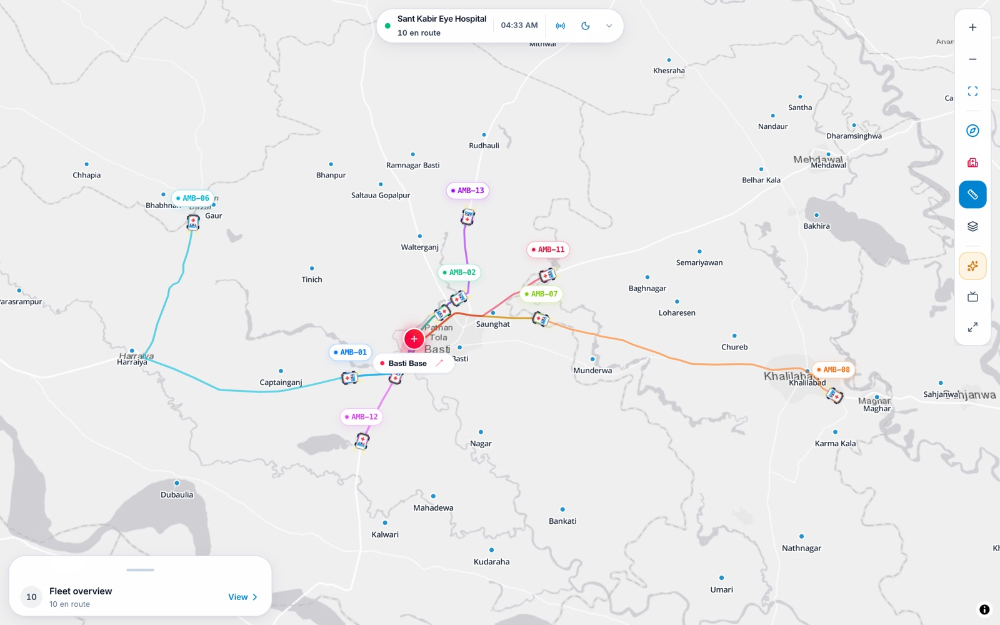
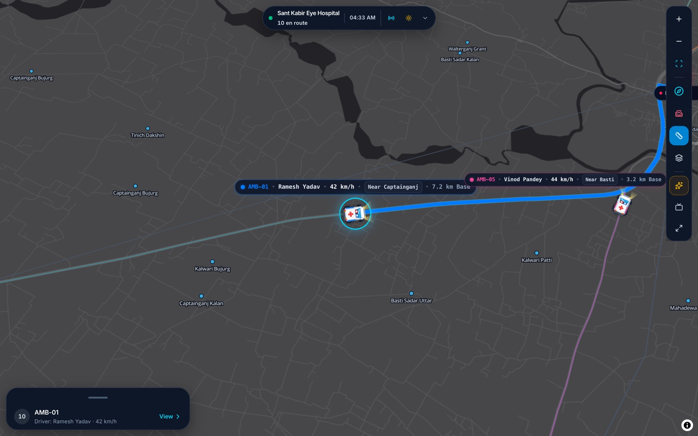
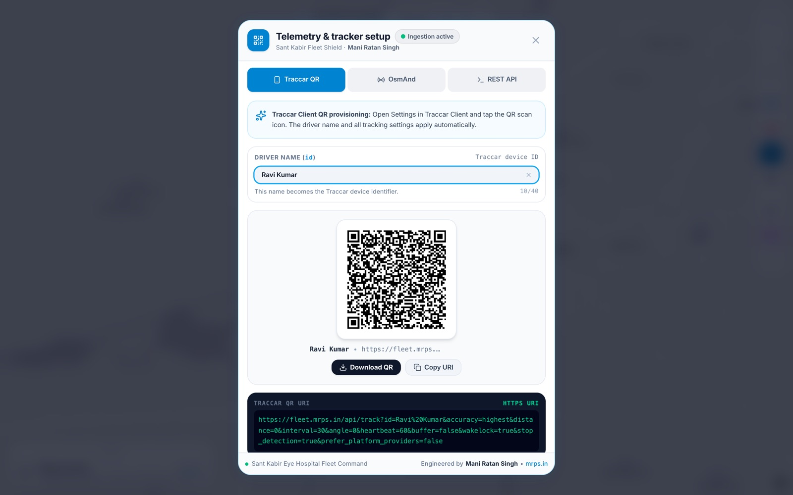
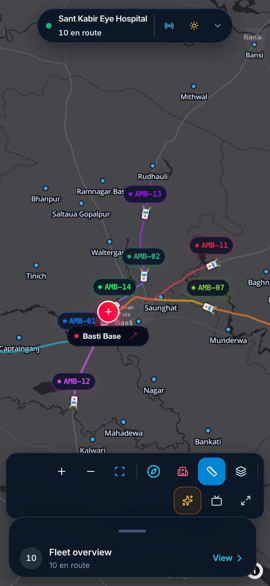
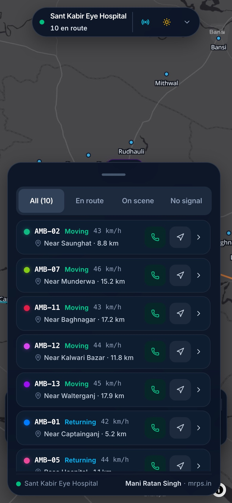

# Screenshots

Fresh captures of the current wallboard in demo mode.

- **Captured:** 10 November 2026
- **Desktop:** 1440 × 900 CSS px at 2× DPR, exported at 1600 px wide
- **Mobile:** 390 × 844 CSS px at 3× DPR, exported at 780 px wide
- **Data:** demo fleet only (`?demo=true`). No production telemetry is shown.
- **Map tiles:** Esri Light Gray, Dark Gray and Streets.

  

<em>Fleet overview. Compact tags at this zoom, route ribbons to the Basti base, and the fleet sheet in its peek state.</em>

## Fleet overview

<table>
  <tr>
    <td width="50%">
      
       <strong>Dark overview</strong> 
      Ten demo ambulances, five fleet states, base-anchored route ribbons.
    </td>
    <td width="50%">
      
       <strong>Light overview</strong> 
      The same board on the light basemap.
    </td>
  </tr>
  <tr>
    <td width="50%">
      
       <strong>Marker close-up</strong> 
      Full tag at close zoom: ID, driver, speed, nearest place and distance.
    </td>
    <td width="50%">
      
       <strong>Fleet summary</strong> 
      En route, on scene, at base and fleet totals, with link to the full list.
    </td>
  </tr>
</table>

At overview zoom the vehicle icon scales down and the tag collapses to the ID.
The icon stays centred on the GPS point; tags float above it and never change
the marker's anchor. Overlapping ID pills are suppressed in dense clusters. The
selected or hovered vehicle always shows its tag.

## Fleet sheet

<table>
  <tr>
    <td width="50%">
      
       <strong>Dark fleet list</strong> 
      Priority sorting, four filters, live state and distance for each vehicle.
    </td>
    <td width="50%">
      
       <strong>Light fleet list</strong> 
      The same sheet and controls on the light theme.
    </td>
  </tr>
  <tr>
    <td width="50%">
      
       <strong>Vehicle detail</strong> 
      Driver contact, coordinates, Maps links, distance and live speed.
    </td>
    <td width="50%">
      
       <strong>Provisioning</strong> 
      Driver name, server selection and the one-scan Traccar QR. All tracking settings are inside the QR.
    </td>
  </tr>
</table>

## Telemetry and routing

<table>
  <tr>
    <td width="50%">
      
       <strong>Telemetry setup</strong> 
      Android QR, OsmAnd and REST API tabs with the exact provisioning schema.
    </td>
    <td width="50%">
      
       <strong>Base-anchored routes</strong> 
      Every visible corridor converges on Sant Kabir Eye Hospital, Basti.
    </td>
  </tr>
</table>

Khalilabad appears as a town and a road destination only. It is not a base,
hub or route origin.

## Mobile

<table>
  <tr>
    <td width="40%">
      
       <strong>Overview</strong> 
      390 × 844. Compact island, bottom control dock and peek sheet.
    </td>
    <td width="40%">
      
       <strong>Fleet list</strong> 
      Full-width sheet with 44 px touch targets on coarse pointers.
    </td>
  </tr>
</table>

## Historical audit

The before/after UI audit is kept as a separate report:

- [`reports/ui-audit/index.html`](../reports/ui-audit/index.html)
- [`reports/ui-audit/`](../reports/ui-audit/)

The after-images in that report were refreshed with the current build. The
before-images are the original captures and are kept for comparison.
