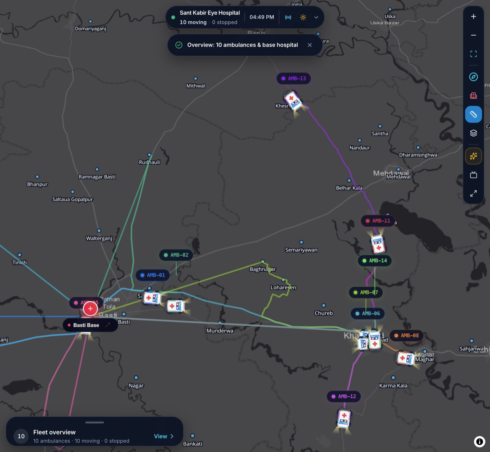
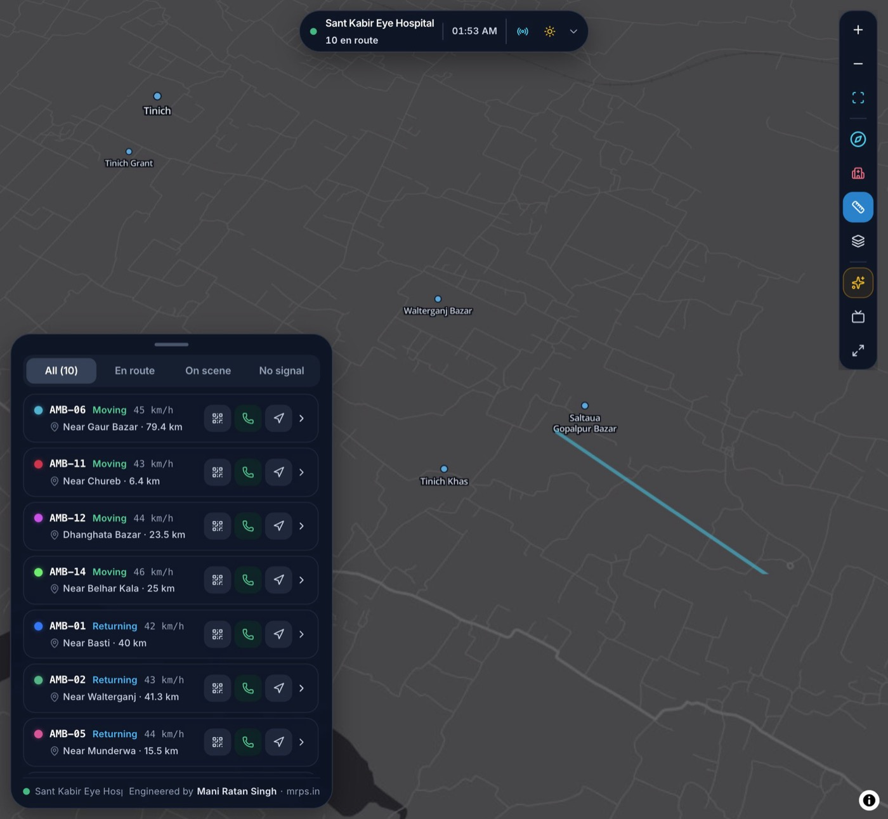
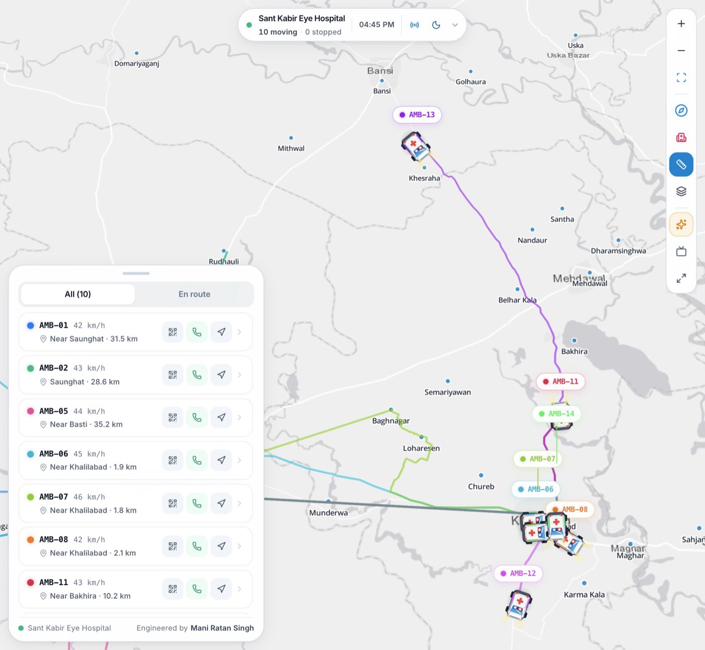
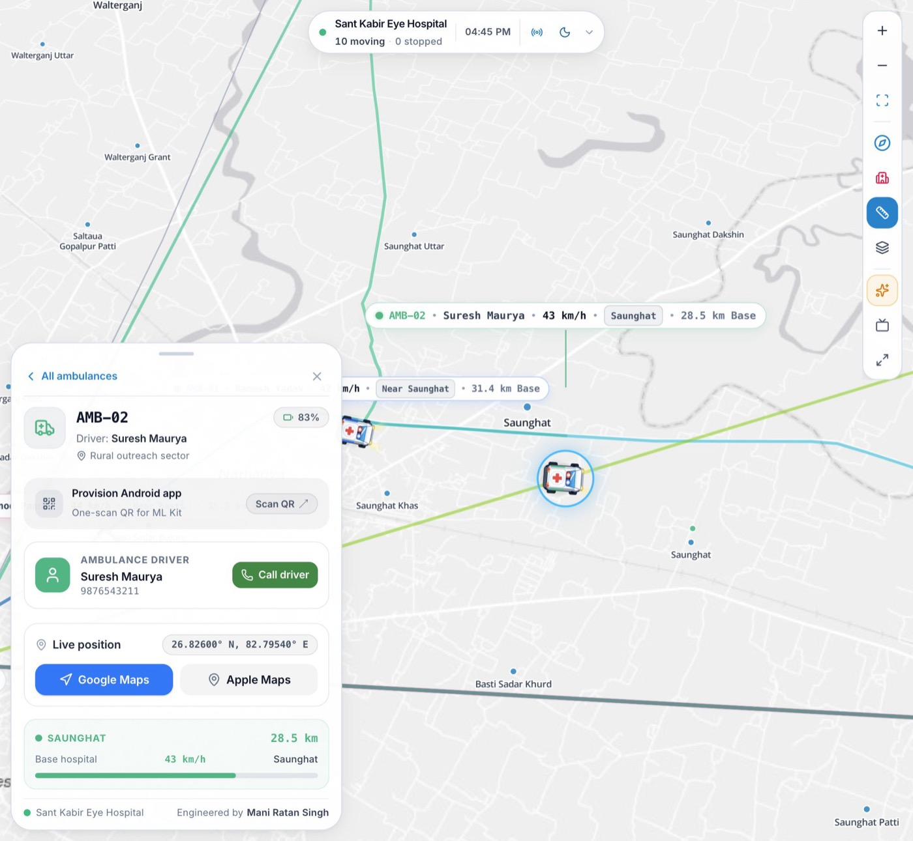
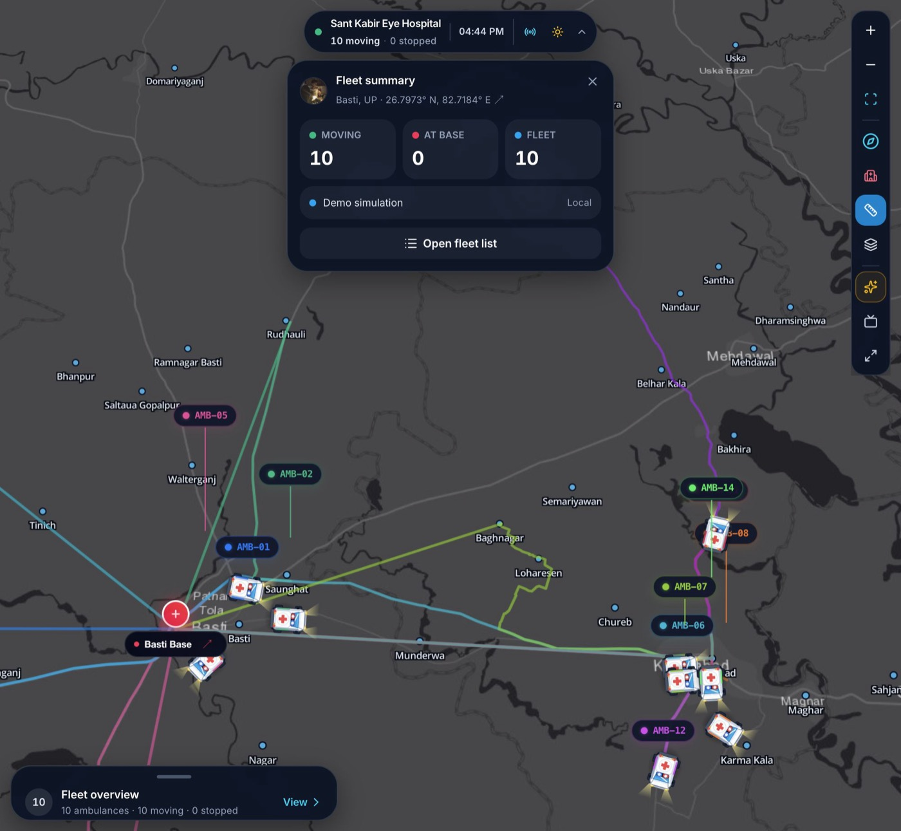
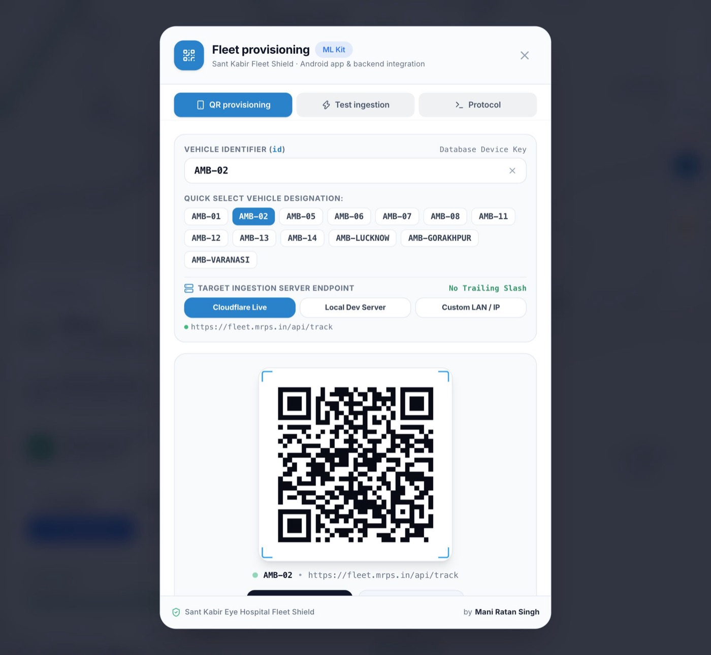
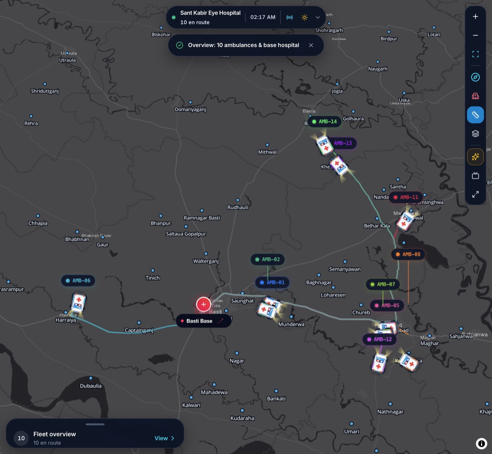

# Screenshots

A visual tour of the current Fleet Shield wallboard, captured in demo mode.

  

<em>TV wallboard overview — dark canvas, base-anchored routes and compact vehicle tags.</em>

## Fleet operations

<table>
  <tr>
    <td width="50%">
      
       
      <strong>Operational fleet list</strong> 
      Priority sorting, four state filters, and real states: Moving, On scene, Returning, At base, No signal.
    </td>
    <td width="50%">
      
       
      <strong>Light theme</strong> 
      The same fleet sheet on the clinical light canvas.
    </td>
  </tr>
  <tr>
    <td width="50%">
      
       
      <strong>Vehicle detail</strong> 
      Fleet-colour hero, driver contact, live position, navigation, distance and telemetry.
    </td>
    <td width="50%">
      
       
      <strong>Summary popover</strong> 
      En route, on scene, at base and fleet totals, with live connection state.
    </td>
  </tr>
</table>

## Provisioning and routing

<table>
  <tr>
    <td width="50%">
      
       
      <strong>Provisioning</strong> 
      Two-column desktop layout: settings on the left, one-scan QR on the right.
    </td>
    <td width="50%">
      
       
      <strong>Base-anchored routes</strong> 
      Every corridor starts at Sant Kabir Eye Hospital, Basti — not Khalilabad.
    </td>
  </tr>
</table>

  <em>Captured at 2000×1845 and resized for documentation. Demo data only.</em>

## Audit deck

The full before/after UI audit is available at:

- [`reports/ui-audit/index.html`](../reports/ui-audit/index.html)
- [`reports/ui-audit/`](../reports/ui-audit/)
